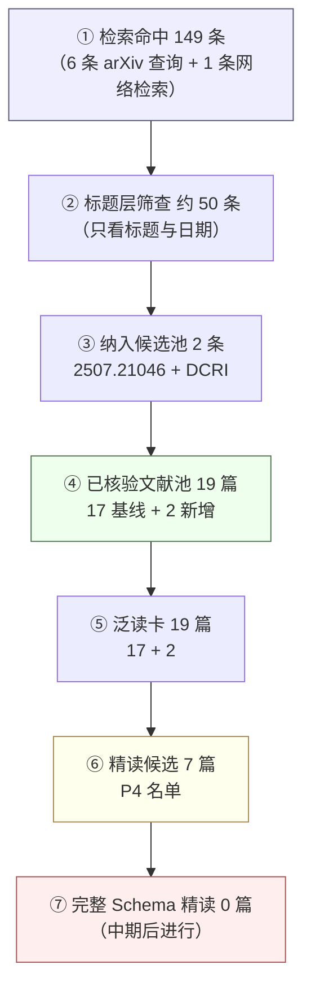

# P1 · 筛选漏斗：检索 → 核验 → 泛读 → 精读

> 负责人：P1（xyc）｜日期：2026-10-31
> 原则：只报实际做过的数量。检索命中数 ≠ 阅读数 ≠ 入库数，三层分开记录。

## 1. 漏斗（数字版）

| 阶段 | 数量 | 口径 / 依据 |
|---|---|---|
| ① 检索命中 | **149 条**（去重约 147） | 本轮 6 条 arXiv API 查询的 `totalResults` 之和，外加 1 条网络精确检索（见 §2）。命中记录数，不是读过的篇数 |
| ② 标题层筛查 | **约 50 条** | 只看了标题与日期：137 条的结果集按提交时间取前 40 条，其余查询结果全看 |
| ③ 纳入候选池 | **2 条** | `arxiv-2507.21046`（唯一题名精确命中）+ `venue-2026-dcri-survey`（arXiv 无，经网络检索定位到 Preprints.org） |
| ④ 已核验文献池 | **19 篇** | CP0 基线 17 篇（2026-10-12 核验）+ 本轮 2 篇 |
| ⑤ 泛读卡 | **19 篇** | `notes/skim/` 17 张旧卡 + 2 张新卡 |
| ⑥ 精读候选 | **7 篇** | P4（zgj）冻结名单，见 [`../p4/plan.md`](../p4/plan.md) §2 |
| ⑦ 完整 Schema 精读 | **0 篇** | 中期后进行，当前不得记为已完成 |

**两个比率**：

- 入库 → 精读：**19 → 7，36.8%**
- 精读 → 已精读：**0 / 7**（CP1 时点状态）

## 2. 检索日志（可复核）

| # | 查询式 | 渠道 | `totalResults` | 处理 |
|---|---|---|---|---|
| 1 | `ti:"Survey of Self-Evolving Agents"` | arXiv API | 1 | ✅ 命中 `2507.21046`，入库 |
| 2 | `ti:"Data-Centric Recursive Improvement"` | arXiv API | 0 | ❌ 无 arXiv 版本，转网络检索（#7） |
| 3 | `all:"data-centric recursive"` | arXiv API | 2 | 均为无关工作：`2609.36675`（Gödel Forest，方法）、`2610.15782`（RSI-Nav，导航），不入库 |
| 4 | `ti:"data-centric recursive"` | arXiv API | 2 | 同上，交叉确认 |
| 5 | `ti:"self-evolving agents"` | arXiv API | 137 | 按提交日期降序取前 40 条看标题，用于确认「是否另有同名综述」；未发现第二篇题名匹配 |
| 6 | `abs:"recursive self-improvement" AND abs:"survey"` | arXiv API | 7 | 与既有 5 篇综述重复或为邻近主题，无新增 |
| 7 | `"Data-Centric Recursive Improvement for Foundation Models"` | Web 检索 | — | ✅ 定位到 Preprints.org（DOI `10.20944/preprints202609.0154`）、GitHub companion repo、Google Scholar 记录 |

> 检索日期统一为 **2026-10-31**。查询式可重放：
> `https://export.arxiv.org/api/query?search_query=<查询式>&max_results=40`

## 3. 漏斗图



纯文本版（不能渲染 mermaid 时使用）：

```
① 检索命中        149 ─┐
② 标题层筛查     ~50  │  逐层是「不同口径」，不是同一批东西被过滤
③ 纳入候选池       2  │
④ 已核验池        19  │
⑤ 泛读卡          19  │
⑥ 精读候选         7  │  36.8%
⑦ 已精读           0  ┘
```

## 4. 与 Checkpoint 口径的对照

`midpre-checkpoint.md` 的 CP1 标准写的是「检索 → 19 核验 → 19 skim → 7 精读候选」。对应关系：

| Checkpoint 说法 | 本文件 | 是否一致 |
|---|---|---|
| 19 核验 | ④ 已核验文献池 = 19 | ✅ |
| 19 skim | ⑤ 泛读卡 = 19 | ✅ |
| 7 精读候选 | ⑥ = 7 | ✅ |
| 「检索」（未给数） | ① 149 / ② ~50 / ③ 2 | ✅ 补上具体口径，未把 149 说成「读了 149 篇」 |

## 5. 口径说明

149 是查询命中数，不是阅读数；真正进入人工判断的是约 50 条标题，最终只有 2 条新增入库。
任何引用这组数字的场合都须保留这一区分，否则会与 ④ 的 19 篇冲突。
